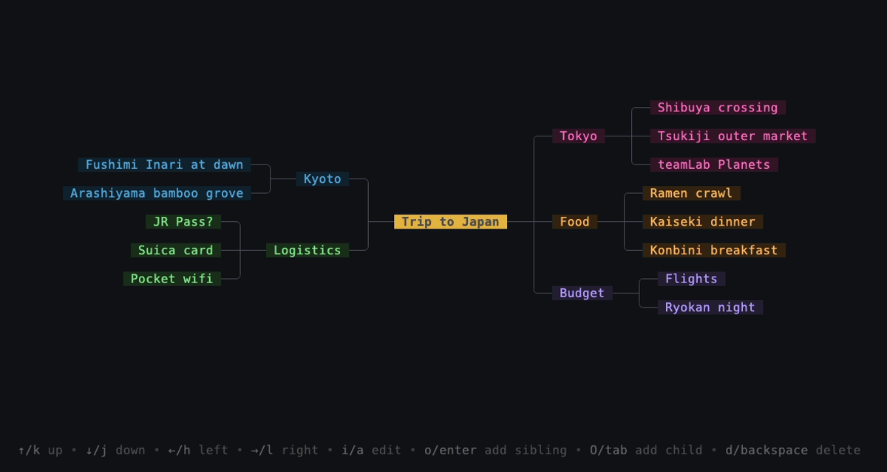

# h-m-m.go

**h-m-m** (pronounced like the interjection "hmm") is a simple, fast,
keyboard-centric terminal tool for working with mind maps. This is a Go
take on [nadrad/h-m-m](https://github.com/nadrad/h-m-m), built on
[Bubble Tea](https://github.com/charmbracelet/bubbletea) and
[Lip Gloss](https://github.com/charmbracelet/lipgloss).



Your map grows out from the root in both directions, the way you'd sketch
it on paper. You move around it with arrow keys or `hjkl`, add and edit
nodes without lifting your hands off the keyboard, and every change is
written straight back to a plain OPML file.

## Features

- **Bidirectional tidy-tree layout.** Top-level branches are split between
  the left and right of the root, and every subtree is packed with the
  non-layered tidy tree algorithm (van der Ploeg, 2014), the same one
  behind Mermaid's tidy-tree mind maps. Boxes of any size never overlap,
  and each parent is centred on its children.
- **Spatial navigation.** `←↓↑→` / `hjkl` move to the box that is actually
  in that direction on screen, not merely the next node in tree order.
- **Modal editing.** Vi-style normal and edit modes. The layout redraws
  live while you type, multi-line nodes included.
- **Colour-coded branches.** Each top-level branch gets its own colour from
  the palette, and its descendants inherit it. Colours are saved to the
  file, so you can tweak them by hand.
- **Collapsible subtrees.** `Space` hides everything below a node, and a
  `+N` marker shows how many nodes are tucked away.
- **Mouse support.** Click a node to select it, or drag to pan the canvas
  like a map.
- **Autosave to OPML.** Changes are saved as soon as you leave edit mode,
  delete or reorder a node. OPML opens in most outliners and mind-mapping tools.
- **Built-in help.** The bottom line always shows the keys for the current
  mode. Press `?` to see all of them.

## Installation

### Prebuilt binary (Linux and macOS)

Download the archive for your platform from the [latest release](https://github.com/trekdemo/h-m-m.go/releases/latest), extract it, and put `hmm` on your `$PATH`:

On macOS, a binary downloaded through a browser may be quarantined; clear it with `xattr -d com.apple.quarantine hmm`.

### From source

You need [Go](https://go.dev/dl/) 1.25 or newer.

```sh
git clone https://github.com/trekdemo/h-m-m.go.git
cd h-m-m.go
make build                # produces bin/hmm
cp bin/hmm ~/.local/bin/  # or anywhere on your $PATH
```

Or, to try it without installing:

```sh
go run . docs/demo/trip.opml
```

## Usage

```sh
hmm path/to/map.opml
```

- If the file exists, it is loaded.
- If the file doesn't exist, you start with an empty root node, and the
  file is created the first time you save.
- Without an argument, `hmm` opens `docs/tutorial.opml`, a mind map that
  teaches you the key bindings. Run it from the repository root.

## Key bindings

### Normal mode

| Key                     | Action                                       |
| ----------------------- | -------------------------------------------- |
| `↑` `↓` `←` `→` / `k` `j` `h` `l` | Move to the nearest node in that direction |
| `i`, `a`                | Edit the selected node                       |
| `o`, `Enter`            | Add a sibling below the selected node and edit it |
| `O`, `Tab`              | Add a child to the selected node and edit it |
| `d`, `Backspace`        | Delete the selected node and its subtree     |
| `K`                     | Move the node up among its siblings          |
| `J`                     | Move the node down among its siblings        |
| `Space`                 | Collapse or expand the selected node         |
| `?`                     | Toggle the full help                         |
| `q`, `Esc`, `Ctrl+C`    | Quit                                         |

Adding a sibling to the root adds a child instead, since the root has no
siblings. The root itself can't be deleted.

Collapsing a node hides everything below it until you expand it again.
A collapsed node shows a stub and a count of the hidden nodes, such as
`Tokyo ─ +3`, on the side its children grow on.
Collapsing is just a way of looking at the map: it isn't saved, so a map
always opens fully expanded. The root and nodes without children can't be
collapsed. While a node is collapsed, the arrow keys treat it as if it had
no children.

### Edit mode

| Key            | Action                                            |
| -------------- | ------------------------------------------------- |
| any text       | Insert at the cursor                              |
| `←` `→`        | Move the cursor                                   |
| `Home` / `End` | Jump to the start / end of the text               |
| `Backspace`    | Delete the character before the cursor            |
| `Delete`       | Delete the character after the cursor             |
| `Enter`        | Insert a newline (nodes can span several lines)   |
| `Esc`          | Leave edit mode and save                          |

If you leave edit mode on a node with no text and no children, the node
is removed. So `o` followed by `Esc` doesn't leave empty boxes behind,
while clearing the text of a node with children never deletes them.

### Mouse

| Action      | Effect             |
| ----------- | ------------------ |
| Click       | Select a node      |
| Click a `+N` marker | Expand a collapsed node |
| Click + drag | Pan the canvas    |

## File format

Maps are stored as [OPML 2.0](http://opml.org/spec2.opml): plain XML with
one `<outline>` element per node. h-m-m.go adds an optional `color`
attribute and leaves everything else standard:

```xml
<?xml version="1.0" encoding="UTF-8"?>
<opml version="2.0">
  <head>
    <title>Trip to Japan</title>
  </head>
  <body>
    <outline text="Trip to Japan">
      <outline text="Tokyo" color="#ff6ac1">
        <outline text="Shibuya crossing"></outline>
      </outline>
      <outline text="Kyoto">
        <outline text="Fushimi Inari at dawn"></outline>
      </outline>
    </outline>
  </body>
</opml>
```

Nodes without a `color` get one from the palette when the map is loaded,
so OPML exported from other tools looks right straight away.

## How it works

For the curious, this is how a frame gets drawn:

1. **Layout** ([`layout/`](layout)): the root's
   children are split into a left half and a right half. Each half is laid
   out top-down with the linear-time tidy tree algorithm, then rotated so
   depth runs horizontally away from the root.
2. **Navigation** ([`navigator/`](navigator)): each arrow key looks for
   the nearest box within a 45° cone in that direction. The distance is
   measured edge to edge and sideways offset is penalised, so the
   selection goes where your eye expects. The node's parent and children
   are preferred over cousins.
3. **Rendering** ([`render/`](render)): connector lines are collected
   cell by cell, so where several edges meet, the right junction glyph
   (`┤`, `┼`, …) is drawn. Boxes are then composited on top with a Lip
   Gloss canvas, and anything outside the viewport is skipped.

The node ties these together: each package declares what it needs from a
node, and the one node type provides it. See
[`docs/architecture.md`](docs/architecture.md) for how the packages fit
together and how to add a layout algorithm.

## Development

```sh
make test    # go test -race ./...
make build   # tidy, format and build bin/hmm
make run     # go run ./
make demo    # re-record docs/demo/demo.gif with VHS
make help    # list all targets
```

The demo GIF and screenshot are generated from
[`docs/demo/demo.tape`](docs/demo/demo.tape) with
[VHS](https://github.com/charmbracelet/vhs), so they can be re-recorded
after UI changes.

## Status and roadmap

h-m-m.go is a young project and doesn't do everything the original
h-m-m does yet. Today it covers the core loop: open a map, navigate,
add, edit, delete, reorder, collapse and autosave. Things that would
bring it closer to the original include:

- [x] Collapsing and expanding subtrees
- [ ] Search
- [ ] Undo / redo
- [ ] Copy, cut and paste of subtrees
- [ ] Moving nodes to a different parent
- [ ] Import/export of h-m-m's tab-indented text format
- [ ] Configurable key bindings and colours

Issues and pull requests are welcome. For a larger change, please open an
issue first so we can talk it over.

## Acknowledgements

- [nadrad/h-m-m](https://github.com/nadrad/h-m-m), the original PHP tool
  and the inspiration for this one.
- [Charm](https://charm.sh)'s Bubble Tea, Bubbles, Lip Gloss and VHS.
- A. van der Ploeg, *Drawing Non-layered Tidy Trees in Linear Time*,
  Software: Practice and Experience, 2014.

## Releasing

Releases are built by [GoReleaser](https://goreleaser.com) in GitHub Actions
(`.github/workflows/release.yml`). Push a semver tag and the workflow runs the
tests, then publishes `tar.gz` archives for Linux and macOS (amd64 and arm64)
plus a `checksums.txt` to a GitHub release:

```sh
git tag v0.1.0
git push origin v0.1.0
```
