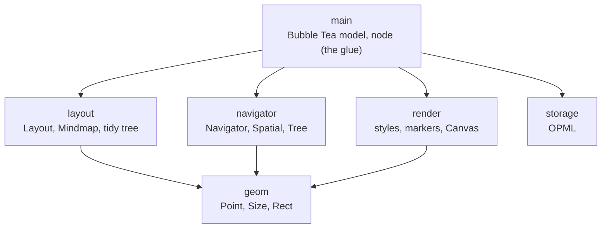

# Architecture

The node is the glue. Each aspect of the app lives in its own package and
declares the small slice of a node it needs. `*node` in package `main`
provides all of them, and `main` wires the aspects together.

Arrows point only downwards. None of the aspect packages imports `main` or
each other, so each one can be read and tested on its own. `geom` is the
shared vocabulary: every aspect talks about where things are in canvas
coordinates.

## What each aspect asks of a node

| Package     | Asks for                                                          | Node sees                    |
| ----------- | ----------------------------------------------------------------- | ---------------------------- |
| `layout`    | `Size`, `Bounds`, `Children`, `SetPosition`, `Overhang`           | visible children             |
| `layout`    | `Side`, `SetSide` (only `Mindmap`, via `SidedNode`)               | root's children              |
| `navigator` | `Bounds`, `Parent`, `Children`                                    | visible children             |
| `storage`   | `OutlineText`, `OutlineColor`, `OutlineChildren`                  | all children, hidden or not  |
| `render`    | nothing: callers hand it rectangles, routes and rendered strings  |                              |

`layout.Node` and `navigator.Node` are generic constraints over the
caller's own node type, such as `navigator.Node[N]`, not plain
interfaces. There are two reasons:

- One Go type can't have two `Children` methods. If each package defined
  `Children() []navigator.Node` and `Children() []layout.Node`, a single
  `*node` couldn't satisfy both. With the constraint, both packages accept
  `Children() []*node`.
- Results come back as `*node`. Navigators return the caller's type, so
  there's no type assertion after a move, no copying children into a slice
  of interfaces, and no typed-nil trap in `Parent`.

`storage.Outline` stays a plain interface. It needs every child, hidden ones
included, so it wants a differently named method anyway.

The block of `var _ … =` declarations at the top of `tree.go` stops
compiling if `*node` ever stops satisfying one of these.

## Adding a layout algorithm

1. Add a type to `layout` that implements `Layout[N]`. `Arrange(root)`
   positions every node reachable through `Children`, and
   `Route(parent, child)` returns the connector as a polyline of
   horizontal and vertical runs.
2. If it needs more from a node than `layout.Node` gives, declare that in a
   constraint of its own, the way `Mindmap` asks for `SidedNode`, and add
   the methods to `*node`.
3. Set it as `layout:` in `newModel`, or switch `m.layout` at runtime. The
   model only ever calls `m.layout.Arrange` and `m.layout.Route`.

Navigators work the same way through `navigator.Navigator[N]` and
`m.nav`.

## Drawing a frame

`model.View` calls `drawCanvas`, which:

1. Starts a `render.Canvas` over the viewport (its offset and size in
   canvas coordinates).
2. Adds `m.layout.Route(n, child)` for every visible parent–child pair.
   The canvas ORs the directions each route passes through every cell, so
   where sibling connectors share a trunk, the cell draws as a junction
   (`┤`, `┼`, …) rather than whichever line came last.
3. Draws every box, and every collapsed node's marker, as an already
   rendered string at its bounds. A box the viewport doesn't overlap is
   skipped. Markers are culled on their own, since a marker can be on
   screen while its box isn't.
4. `Render` writes the line cells first and then composites the boxes on
   top, so box edges always cover the lines that run into them.

A node's size comes from `render.Size`, which measures with the same
`boxStyle` that `render.Node` and `render.Selected` build on. That's what
keeps a box the same size when it's selected.
